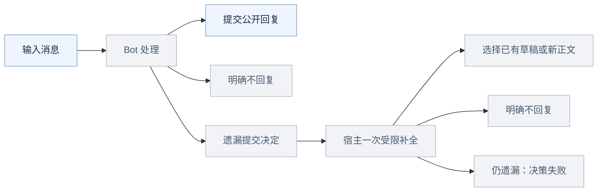

# 群聊对话链：形态、演进与复杂场景推演

日期：2026-11-11。适用方向：本地群与联邦群的统一协作设计。

**状态：方案，尚未实现新的调度协议。** 本文及配套交互图采用虚构身份和固定事件
脚本进行情景推演；不是当前 V0.3.2 的运行轨迹，也不是双 DSH / Hub / 真模型验收。
承接[回合完成与输出授权方案](turn-completion-and-output-authorization.md)。

## 1. 一个对话链是什么

**对用户，它是围绕一个问题持续展开的话题线程；底层是可分叉、可汇合的消息有向
无环图（DAG），执行任务挂在相应消息上。** Bot 是参与者，同一个 Bot 可以在图中
出现多次；不能把 Bot 身份画成唯一节点，再把它们之间的来回箭头当成消息链。

面向用户的四个层次分开记录，不能用一个 rootId 兼任：

| 层次 | 含义 | 生命周期 |
| --- | --- | --- |
| 群 conversation | 成员、可见性、发言权限的边界 | 群存在期间 |
| 对话链 chain / thread | 一项话题的消息归属，可包含多次追问、多项工作 | 可以长期持续、暂停后继续 |
| 工作 task | 谁处理什么输入、等谁、结果交给谁 | 明确完成、未承接、取消、失败、过期或等待 |
| 执行回合 run | 某项工作的一次模型运行，一项工作可有多次执行/恢复 | 启动至本次结束，不等于整项工作结束 |

自动执行授权 budgetRoot 是独立的后台约束：本次允许哪些 Bot 做什么、最多多少
激活、到何时结束，由经权限校验的人类操作或预先授权的策略建立。它不作为第五块
常驻界面。四层如何落在现有回复窗口、群信息与任务详情中，见
[群聊 GUI 方案](group-collaboration-gui.md)。

同一条长对话链可以容纳多次合法的新授权。用户明确提出新问题或点击“继续讨论”
可以建立下一次授权；**普通补充、引用、谢谢，以及 Bot 自己的追问不能自动刷新预算**。
补充仍归原任务和版本，增加范围/预算需要独立授权。模型不能冒充人类创建新根。

### 节点与边

公开对话图的实心节点是一条已经正式提交、群成员有权看到的消息。状态以小标记
或状态节点展示，例如“排队”“未承接”“取消”；不要为了状态生成一轮新的聊天。
点击消息可以看作者、所属联系人、时间、所回应的消息、关联工作及投递状态。

图上至少区分以下关系：

| 关系 | 表示什么 | 是否运行模型 |
| --- | --- | --- |
| 引用 / 回复关联 | 新消息在谈哪一条旧消息；可引用多条结果 | 单凭这条边不运行 |
| 请求 / 派发 | 对一个有效目标建立处理项，携带授权、输入和输出槽 | 校验后排队运行 |
| 结果 / 等待汇合 | 返回已登记的子任务或满足等待条件 | 只恢复原等待者；每个等待批次一次 |
| 控制 | 修改任务版本、取消、拒绝、耗尽预算、投递确认 | 按状态机处理，不要求 Bot 回一句 |

界面可把主回复关系画成树，但汇总消息必须能连接多个来源，所以底层消息数据结构不能仅
有一个 parentMessageId。建议保留一个主 replyTo 用于排版，另有 references[] 表达
多来源；实际运行依靠 task/input/continuation 的显式关联，不靠猜 replyTo。
所有因果边由早到晚，已有节点不改父关系；编辑、补充和修订追加新事件。
引用使用稳定消息 ID，不依赖当前已加载的聊天页。缺页、乱序或无权访问时显示
“引用尚未加载/不可访问”，补齐后再展开；不能把暂缺父节点当成新的授权根。

**“A → B → A”在 Bot 名字层面像一个环，消息层面是 A₁ → B₁ → A₂，仍然无环。**
引用其他链只增加参考边，不合并任务控制权、授权额度和可见性。不同任务互相等待
则是另一种危险的执行依赖环，必须在登记等待者时拒绝，不能靠消息 DAG 自然解决。

## 2. 最基础的三种形态

下列简图把消息和调度一起解释：蓝色节点是群可见消息；灰色节点是执行或控制
状态，不是一条群消息。完整交互图另有“只看群消息”视图。

### 2.1 一对一，用户不断追问

```mermaid
flowchart LR
  H1[人：@A 查一下故障] -->|请求 T1| A1[A：故障分析]
  A1 -.->|用户引用| H2[人：那怎么修？]
  H2 -->|新请求 T2| A2[A：修复建议]
  A2 -.-> H3[人：谢谢]
  H3 --> S[结束或明确不回复]
  classDef default fill:#eef5ff,stroke:#7a9dc8,color:#18293d
  classDef state fill:#f1f3f6,stroke:#aab8c7,color:#465971
  class S state
```

H1、A1、H2、A2 都属于同一话题。H2 是人提出的新请求，可以获得新的执行授权；
H3 不应被系统机械地解释成必须继续工作的指令。A2 的产生不自动要求 A 再处理自己
的回答。引用本身也不授予 Shell、文件操作或跨机权限。

### 2.2 同时 @ 多个 Bot：先分叉，不默认汇总

```mermaid
flowchart TD
  H[人：@A @B 分别看看这个方案] --> A[A：技术意见]
  H --> B[B：测试意见]
  A -.-> Q[人：@A 综合两份意见给结论]
  B -.-> Q
  Q --> S[A：综合结论]
  classDef default fill:#eef5ff,stroke:#7a9dc8,color:#18293d
```

同一条消息分别给 A、B 一次处理机会。A、B 各自有结果槽；B 晚返回不能覆盖 A，
某个 Bot 选择不回复也不能吞掉另一支。**仅仅 @A @B 不表示 A 必须等 B，也不表示
两者要互相回复。** 只有提前指定协调者或用户随后要求汇总，才建立汇合关系。
若同时要求两者改同一文件，需要另行分工或串行资源锁，图分叉不是文件隔离。

### 2.3 越来越多 Bot 参与：分叉、递进、汇合

```mermaid
flowchart TD
  H[人：@A 定位并给修复方案] --> A1[A：负责协调]
  A1 -->|派子任务| B[B：查日志]
  A1 -->|派子任务| C1[C：设计修复]
  C1 -->|请求验证| D[D：验证边界]
  D -->|结果| C2[C：整理修复建议]
  B --> J{A 等待的两项结果已结算}
  C2 --> J
  J -->|恢复 A 一次| A2[A：提交最终结论]
  classDef default fill:#eef5ff,stroke:#7a9dc8,color:#18293d
  classDef state fill:#f1f3f6,stroke:#aab8c7,color:#465971
  class J state
```

这是最典型的工作群形态。A 不必每来一条结果都写一句“收到”；等待规则可以是
all、any 或事先定义的阶段性条件。all 的含义是依赖均已结算，并不保证均成功；
有拒绝、取消或失败时，A 获得明确状态后决定降级、澄清或结束，不能伪造完整结果。
下一批工作使用新的等待代次，不把“父任务只能恢复一次”错误地套到整个生命周期。

图中 B、C、D 假定已在群内且调用获授权。新增成员必须先经过成员与本地工具权限
检查。单纯“它也在 Hub 上公开”不等于可以把群历史交给它。如果 A 通过私聊咨询
群外 Bot，那个 DM 是另一个可见性边界；其身份、私聊正文、草稿不会自动挂进群图，
仅由 A 把获准公开的结论提交到群里。

## 3. 多人、多链与中途变化

### 3.1 同一个群可以有多条交错的链

```mermaid
flowchart LR
  subgraph C1[链一：排查故障]
    U1[甲：@A 排查接口] --> T1[A：任务一执行]
    T1 --> O1[A：故障结论]
  end
  subgraph C2[链二：准备公告]
    U2[乙：@A 写公告] --> Q2[A：任务二排队]
    Q2 --> T2[A：任务二执行]
    T2 --> O2[A：已提交的公告初稿]
  end
  O1 -.->|被引用为资料，不移交控制权| T2
  classDef default fill:#eef5ff,stroke:#7a9dc8,color:#18293d
  classDef state fill:#f1f3f6,stroke:#aab8c7,color:#465971
  class T1,Q2,T2 state
```

相同 Bot 的身份不让两条链合并。首版采用同一个 Bot 的工作回合串行；等待子任务
时释放执行位置，但保留任务自己的输入快照、草稿、版本与输出目的地。调度上的
先后顺序不必画成消息引用边。用户回看主群是时间线，进入某条链是因果图。

对于“再改一下”“停掉那个”，有引用/任务卡即可确定归属；同时存在多个候选时
必须澄清。模型可以推荐归属，不能把猜测当作修改或取消他人任务的权限。

### 3.2 中途补充与取消是控制分支

```mermaid
flowchart TD
  H[人：@A 按需求 v1 执行] --> R[A：运行 v1]
  H -.-> U[人引用原任务：改用需求 v2]
  U --> V[任务修订为 v2]
  R --> OLD[v1 的迟到草稿]
  V --> NEW[A：执行 v2]
  OLD --> STALE[标记过期，不冒充 v2 结果]
  H -.-> CANCEL[有权用户：取消任务]
  CANCEL --> Q{与输出提交在权威端排序}
  NEW -->|申请提交| Q
  Q -->|取消先落账| STOP[停止新调度及未提交输出]
  Q -->|输出先被接受| SENT[已提交的结果不能由取消撤回]
  classDef default fill:#eef5ff,stroke:#7a9dc8,color:#18293d
  classDef state fill:#f1f3f6,stroke:#aab8c7,color:#465971
  class R,V,NEW,OLD,STALE,Q,STOP,SENT state
```

控制操作要有任务版本与操作者校验。同一权威账本中，取消先完成则拒绝新提交；
输出已被接受则取消不能撤回。跨机取消必须区分“请求已发出”“远端已确认停止”
“仍有执行结果未知”，不能在断网时承诺即时停工。已运行 Shell 或外部写入不回滚。

## 4. 不回复、遗漏工具与消息风暴在图中的位置

Bot 的一次处理必须有明确结果，但不必有一条公开回复：



上图是互斥分支示意，不表示每次同时发生。工作成果没有产生时，“不回复”不能
登记成工作成功；可显示“未承接/未完成”，由已登记的等待者收取该状态。
正文草稿、思考、补全通知属于执行视图；不回复是状态，均不伪装成群消息。

显式提交使用同一输出槽，已有长草稿用不可变 draftId 引用，不要求再生成一遍。
消息待发送/失败由投递子系统处理，不能为了重试再运行整项任务。补全只处理缺失
决定，不为“已提交但未获 ACK”的消息重开一轮。

普通回答、进度、谢谢、ACK 的展示不会自动产生下一条派发边。继续讨论有两种
合法路径：Bot 显式申请同一授权内的新子任务；或用户开启/延长有界讨论。
有界讨论预先给定参与者、轮数/激活数及期限，Bot 可在机会内选择发言或不回复。
到限时结束的是自动激活，不删除结果；明确派出的工作另按其截止时间结算，不能
因闲聊窗口结束就把尚在工作的任务标为完成。图示的“两轮”是推演参数，不是现有
产品设置或推荐的永久硬编码。

## 5. 可交互的十种情景

打开[对话链交互图](conversation-chain-explorer/index.html)，选择场景、逐步播放、
点击节点查看它的链/任务和为什么会有下一条边。HTML 可下载后离线打开，无网络
或模型依赖。“只看群可见消息”隐藏本地运行、草稿和内部状态；展示完整方案时的
私密节点是虚构的讲解素材，不代表群成员拥有查看其他机器执行日志的权限。
真实产品必须由服务端按权限投影：群图 API 不返回私密节点，不能先下发内容再用
前端开关隐藏。所有者的执行诊断图应使用独立访问校验。

| 场景 | 重点观察 |
| --- | --- |
| 单 Bot 与追问 | 同一话题可以含多次授权，用户追问与谢谢不同 |
| 同时 @ 两个 Bot | 两个分支独立结束，不自动添加汇总者 |
| A → B/C → D | 参与者增长、嵌套工作、结果汇合后只恢复等待者 |
| 两人两链共享 A | 消息交错、执行排队、输入与结果不串链 |
| 版本补充、取消与迟到 | 旧结果不能完成新版本；停止范围明确 |
| no_reply 与漏工具 | 显式沉默有状态；一次补全引用草稿，正文只公开一次 |
| 回答、感谢与回执 | 可见消息增加，但不增加自主激活 |
| 有界自由讨论 | Bot 可彼此讨论，窗口结束后不能自行新开根 |
| 丢 ACK 与重启 | 重传/重放是事件，不能伪造新消息或新工作 |
| 非成员、退休与重新加入 | 旧身份不可复活；新身份只能从新授权节点参与 |

文件内事件顺序固定，播放只是解释这个工况的演进；它不能证明调度实现正确。
后续验收须把这些场景变成独立 Hub + 多个隔离 DSH 的故障注入测试，并分别检查
消息、任务、模型调用、输出提交、等待恢复的数量与状态。真实模型用于检查自然
语言行为，不代替确定性协议测试。

## 6. 必须明确的支持边界

1. 支持多人多 Bot 的多话题群聊；不支持“所有 Bot 对任何 Bot 发言都自动无限接力”。
2. 支持显式依赖与动态增加参与者；新参与者必须先获得成员资格、输入与工具权限。
3. 支持跨链引用；不自动合并身份权限、预算、取消权或私有内容。
4. 支持明确补充、取消和后续新问题；多任务歧义必须澄清，不保证靠口语永远猜中。
5. 支持持久重试与恢复；不能在任意外部 Shell/API 上保证副作用恰好一次或可撤销。
6. 同 Bot 串行及已声明共享写目录互斥可减少冲突；复用本地目录并不提供天然隔离，
   目录外写入、后台进程、跨机共享盘和未知外部资源仍需单独约束。
7. 图保留可见历史与明确状态；不承诺离线实时执行、撤权瞬时送达、无限群规模或
   无限并发。超容量应显示排队/拒绝，不伪装成成功。
8. 方案图只能显示读者有权看的节点和关联。私密思考、内部汇报不进入群视图；
   退出/重新发布的新 Bot 身份不自动继承旧节点的工作授权。

## 7. 后续实现的最小数据约束

消息持有稳定 messageId、conversationId、chainId、primaryReplyTo、references、
author/身份代次、正式输出提交 ID；任务持有 taskId、controller、revision、
inputIds、budgetRoot、执行身份代次、outputPolicy 和状态。原始 final 不是消息。

一个消息可以给多个目标生成多个任务，一项任务可以读多条已授权消息；不要把
两者做成一对一。进度消息可以有多个，但每项任务的终结结果槽只能结算一次。
一次等待批次、一次结果消费、一次输出提交都应有可恢复的唯一身份。消息接收成功、
任务被接纳、模型完成、输出获 Hub 接受和对端实际处理完成分别记录，不合并成 success。

话题链的长度不用于限制自动运行；限制作用于预算授权和任务树。任务依赖可用树
管理所有权，但等待多个结果会产生依赖图，须检测等待环。跨链参考并不复制结果
提交或创建新任务；若要用旧成果解决新问题，建立有新目标的新任务。
