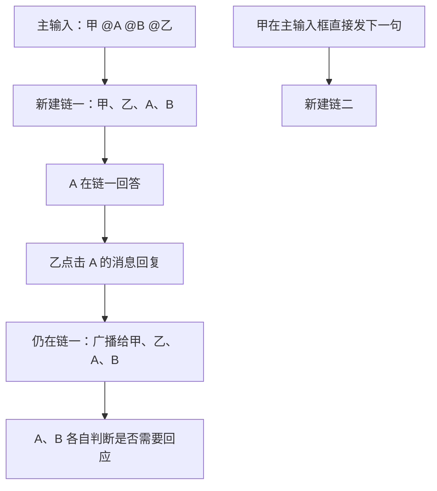

# 首版收敛：以回复链为单位广播交流

> 首版现行方案见 [定向回复链](directed-reply-chain-v1.md)。本文的全链广播或复杂管理界面仅保留为讨论记录，不代表当前实现。

日期：2026-11-11。状态：**根据用户最新反馈整理的方案，尚未编码。**

本文取代前一版 GUI 方案中“话题 / 任务 / 执行回合分别提供用户入口”的首版范围。
旧设计保留作扩展参考；可靠提交、私密正文边界、幂等投递仍然需要，不因为界面简化
而删除。下文分别列用户已经明确的交互，以及为闭环建议的默认行为。

## 1. 用户明确的规则

**主群输入框发起新回复链；点击任意消息的回复按钮，继续那条消息所属的原链。**
不依靠语义判断是否同一话题，不自动把两条链合并，也不在链内建立嵌套的链。

1. 起始消息的发送方与被 @ 的人/Bot 构成初始参与者。
2. 在回复链中发布的每条消息，送达链内所有当前有效参与者；所有参与 Bot 都有
   机会根据内容决定处理并回复，或者明确不回复。
3. 点击 B 的消息回复，只确定引用对象，不把消息收件范围缩成 B。A、C 等其他
   链内 Bot 仍然收到。
4. 链内 @ 表示点名提醒，不建立子链、不自动增加一次重复投递。
5. 主输入框随后直接发的内容属于新链，即使内容接着上一个话题也不例外。

因此，在这个首版定义下，**对话链就是回复链，一条链对应一个讨论串**。此前为了
语义聚合区分的“话题”不再是另一种用户概念。可以有分支引用关系，但接收范围按
整条链计算，不随引用分支变动。

图中的广播表示消息送达，不表示每个节点必然立即产生一轮模型调用。

## 2. 建议补齐的最少成员规则

| 情况 | 建议首版行为 |
| --- | --- |
| 起始 @ 一人或一个 Bot | 发送者与明确点名者加入；不额外叠加默认接收 Bot |
| 起始 @ 多人/多 Bot | 去重后建立参与者列表；调用资格仍按群与本机权限检查 |
| 起始 @all | 取当前群内全部可调用 Bot 的身份快照；不包括 Hub 上尚未入群的公开 Bot |
| 主输入未 @ | 建新链；沿用群已配置的默认接收 Bot，并在发送前显示名单。没有默认接收者时仅含发送者，不唤醒 Bot |
| 链内 @ 已有成员 | 点名强调，不缩小广播范围，也不再额外唤醒一次 |
| 链内 @ 链外成员 | 不暗中加人；提供明确“加入本链”动作，成功后再提醒 |
| 群内其他人主动回复 | 发送前提示将参与本链，发送成功后加入；仅查看不加入 |
| Bot 自己发出的消息 | 留在自己的历史，但不因自己的消息再次启动自己 |
| 新 Bot 发布/新成员进群 | 不自动加入已经存在的 @all 链，也不重放旧消息来逐条激活 |
| Bot 隐藏、退休或离群 | 停止旧身份后续接收/调用；保留历史失效标记，新身份必须重新加入 |

这里的 @all 延续现有“全部 Bot”的含义，与用户举的“@所有 Bot”一致；人类需要
明确点名加入通知范围。选择器及发送前名单要标清，不能把它悄悄解释成所有人。

“主输入未 @”是待采纳的建议，目的是保留已有的群默认接收 Bot 功能，避免第一版
默默改变原设置含义。如果改成无 @ 就不调用 Bot，也可以实现，但必须同时明确
调整默认接收设置，不能让两套规则暗中并存。上述选择均不影响“主输入总是新链”。

**链参与者是接收/通知范围，不是新的隐私边界。** 群消息仍按已有群权限可见。
只想给 B 看应走 DM；回复 B 或只 @B 不会让全链消息变成私聊。
人类参与者接收通知/未读，Bot 参与者另有自动处理队列。

每批 Bot 输入应明确给出链起点、参与者、消息作者、引用对象和是否被点名，并说明
这是全链广播。Bot 没有贡献时可以不参与；被点名也不增加本地权限。判断“不参与”
与“已做工作但不公开答复”不是同一回事：no_reply 只证明没有公开回复，不能证明
没有执行工具，更不能证明请求的工作已完成。状态必须按实际记录描述。

成员变更由有相应权限的人显式操作，按服务端接受时的参与者版本决定每条消息
的投递范围。后来加人不改写旧消息的收件记录，不补造旧处理义务；新成员读取历史
仍受既有群加入边界及可见性限制。首版不开放 Bot 无限自动扩员，Bot 可以建议
需要谁，由有权限的人加入；不妨碍已有的单独 DM 咨询能力。

## 3. 必须区分全量送达与模型运行

“每条消息让全链 Bot 都看到”可以保留；“每条消息立即为每只 Bot 新开一轮模型”
会重新制造风暴。6 个 Bot 首轮各说一句，如果每句又唤醒其余 5 个，会产生 30 个
后继处理请求；这些 Bot 都最终选择不回复，也已经付出判断成本。

最低必要调度规则不暴露为任务管理界面：

- **全量存储、按批处理。** 每条消息进入参与者的持久收件记录。短时间内积累的
  多条新消息合成一个输入批次，同一 Bot 同时只执行一个活动回合；不同链公平排队。
  每批绑定确定的链、输入及输出，不能混入另一条链或跨链复用草稿。初始人数超过
  支持的调用容量时应明确提示；不能静默漏掉一部分已声明的接收 Bot。
- **送达游标与处理游标分开。** 只确认这次模型实际读到的消息范围。运行期间的新
  消息进入下一批，不因为本轮结束就顺手标为已处理，更不另起并发回合。
- **明确回复或不回复。** 原始正文不自动转发；可以提交已有草稿或新回复。遗漏
  决定最多一次补全；仍遗漏、发送失败、明确不回复是三种不同状态。
- **Bot 普通回答也可引发后续处理。** 不能悄悄改成“只有链内被 @ 的 Bot 才处理”。
  但按批次去重、避免自己唤醒自己，@ 也不生成第二份处理项。
  送达确认、已读、no_reply 等控制状态不是聊天消息，不作为新一轮广播唤醒源。
- **自动接力有硬上限。** 限制一段自动交流的总激活、每 Bot 激活、时限及成本；
  所有补全也计入。达到上限停止新增自动处理，不丢消息、不伪装 no_reply。
- **已授权执行的结果仍可提交。** 单纯耗尽唤醒额度不能吞掉正在执行的结果；该
  结果照常保存、显示，但不再制造无限后继激活。身份撤销是另一项权限检查。

建议区分自动额度耗尽和用户手动暂停：

1. 正常的人类后续回复可作为下一段有限交流的人工推进，合并尚未处理的输入；
   或由有权用户点击“继续处理”。Bot 消息和链内 @ 本身不能刷新额度。
2. 用户手动暂停后，即使有人发新消息，也只送达而不自动恢复；需明确点击继续。
3. 新的人类消息需要通过身份、群调用资格及速率/成本限制。不能通过高频人类
   消息无限积压；Bot 不能省略来源、冒充用户，或自行新建链绕过额度。
4. 连续人类消息合并待推进输入或有界排队，不无限叠加额度。同一批输入不能被两段
   交流重复认领；人工推进记录持久化，重投和重启不重复发放额度。

这是针对本次简化交互的建议：**同一链允许多段人工推进的有限自动交流**，无需
用户先管理任务或辨认“是不是新工作”。包括“谢谢”在内的人类新消息仍可能产生
一次有限判断机会，这是保留自由交流体验的成本取舍。具体上限需 Mock 与真实模型
验证后确定；当前讨论没有设定或验证新的默认数值。

后续新要求到达时，旧回合不能声称自己已覆盖这些输入。必要时标识“尚未处理最新
补充”，下一批再处理。模型的精确输入、决定、公开提交和重传身份仍须持久记录，
但不用在主群展示完整任务树或每次执行记录。

## 4. 两人、多 Bot 混合交流的推演

以下是固定情景推演，未运行模型或 Hub 测试：

| 步骤 | 消息与分发 | 允许的行为 |
| --- | --- | --- |
| 1 | 甲主输入 @乙 @A @B @C，请分析故障 | 建链一；甲乙及 A/B/C 参与，三只 Bot 收到 |
| 2 | A 提出原因，B 补充日志，C 正在运行 | 消息都进入链一收件记录；C 不并发重启，后续批次读取新增内容 |
| 3 | 乙回复 A：“@B 请核对这个时间段” | 仍广播给 A/B/C；B 被强调，其他 Bot 可不回复 |
| 4 | C 提交结果，A 给出总结 | 仍属链一，内容公开；不要求所有成员都回复“收到” |
| 5 | 甲主输入“再帮我准备公告 @A” | 建链二；只选择本次参与者，不沿用链一 B/C |
| 6 | 乙继续点链一的旧消息回复 | 明确回到链一，不因链二更新而串链 |
| 7 | A/B 相互确认过多，自动额度耗尽 | 后续消息仍保存，显示已收到但自动处理暂停；已执行的 C 结果不被吞 |

Bot 明确不回复一批消息，不表示退出链。以后有新输入仍可处理。用户自行说“大家
先停一下”可以影响 Bot 判断，但可靠停止要走“暂停 Bot 处理”的宿主控制，不能
把自然语言理解当作停止所有进程的保证。

## 5. 此方案的限制

| 场景 | 首版边界 / 补充方式 |
| --- | --- |
| 链内只想找一个 Bot | @ 是提醒，全链仍收到；定向私密交流使用 DM 或主输入开小链 |
| 一条链越聊越偏 | 不自动拆话题；明确回主输入开新链，可附旧消息引用 |
| 希望自动合并两条链 | 首版不合并；引用只作资料，不复制成员或授权 |
| @all 大群且消息频繁 | Bot 判断本身也有成本；合批、配额、暂停不可省，不能承诺每条都立刻单独调用模型 |
| 多个 Bot 都决定执行同一工作 | 广播讨论不提供唯一认领或副作用互斥；明确负责人有助于协作，但文本 @ 不是锁 |
| 修改同一文件、运行命令 | 复用本地目录与权限继续生效；需要资源互斥/本地审批，不能以消息广播代替安全执行控制 |
| 等齐所有成员结果后再汇总 | 首版不承诺自动 all/any 汇合；可显式指定协调 Bot，由其交流确认，后续再增强可靠依赖 |
| Bot 自主寻找链外专家并扩员 | 首版不自动扩员；允许建议人工加入，或按既有授权单独 DM 咨询 |
| 长链与离线补投 | 分页读取、处理游标、上下文上限仍存在；不保证模型每次完整读遍无限历史，也不能保证离线即时处理 |
| 暂停或移除参与者 | 阻止后续自动调度；不能回滚已执行 Shell 或已经公开的消息 |

特别是多人派活：所有 Bot 可听见和建议，不等于所有 Bot 都得到执行同一副作用的
新权限。“A 执行，其他人评审”可作为协作指令，但要保证只有一次执行，仍需后台
认领/幂等/资源锁等机制；第一版广播规则本身不作这种保证。

## 6. GUI 只保留最小入口

- 主输入框固定显示 **“发起新回复链”**，绝不残留上次回复模式。
- 点击任意消息回复，打开已有独立回复链窗口；固定原始消息、参与者头像/名称，
  底部显示 **“回复本链 · 引用 B 的消息 · 所有链内参与者会收到”**。
- 链内不再分子窗口。逐条引用摘要保留，便于知道在回应哪一句；可折叠分支，但
  折叠不影响投递。
- 只添加参与者管理、暂停/继续，以及必要的状态提示。状态是收到、处理中、
  明确不回复、待处理/已暂停、提交失败，不用任务中心和回合日志淹没普通用户。
  “明确不回复”只描述最近已处理的批次；有更新输入时应显示“新消息待处理”，
  不能继续把整条链显示成已处理。首版无需另做任务取消或话题结束界面。
- 主群可折叠为起始消息加 `12 条回复 · A/B/C`，点击查看；链内新消息有未读标记。
  群信息继续放右侧，现有成员资料入口保持不变。
- 如果用户误在主输入发了续问，可提示如何回复；首版不把已派发消息自动搬进旧链，
  避免重复处理和事后更改接收者。

## 7. 后台的最小可靠记录

不引入独立的语义话题 ID；chainId 可取起始 messageId。每条消息明确 chainId 与
replyToMessageId（仅引用），链记录群 ID、初始/当前参与者身份及版本、暂停原因。
旧身份、群加入边界与本地工作权限照常校验。

宿主还需保存输入批次、处理游标、运行归属、回复决定、唯一公开提交、发送重试及
自动预算。消息进入收件记录不等于已被模型处理。主输入/回复入口和 Bot/CLI 工具
都必须表达新链或续链意图，不能让 Bot 用漏传 chainId 来换根续命。

这些数据服务可靠送达和有界执行，不能用目前的 replyTo 查询或不可靠 no_reply
出口直接冒充。正式实现仍需新增协议能力校验与迁移；GUI 版本不同本身不影响
兼容通信。旧模式可以继续使用，但不能伪称已支持全链广播处理。
