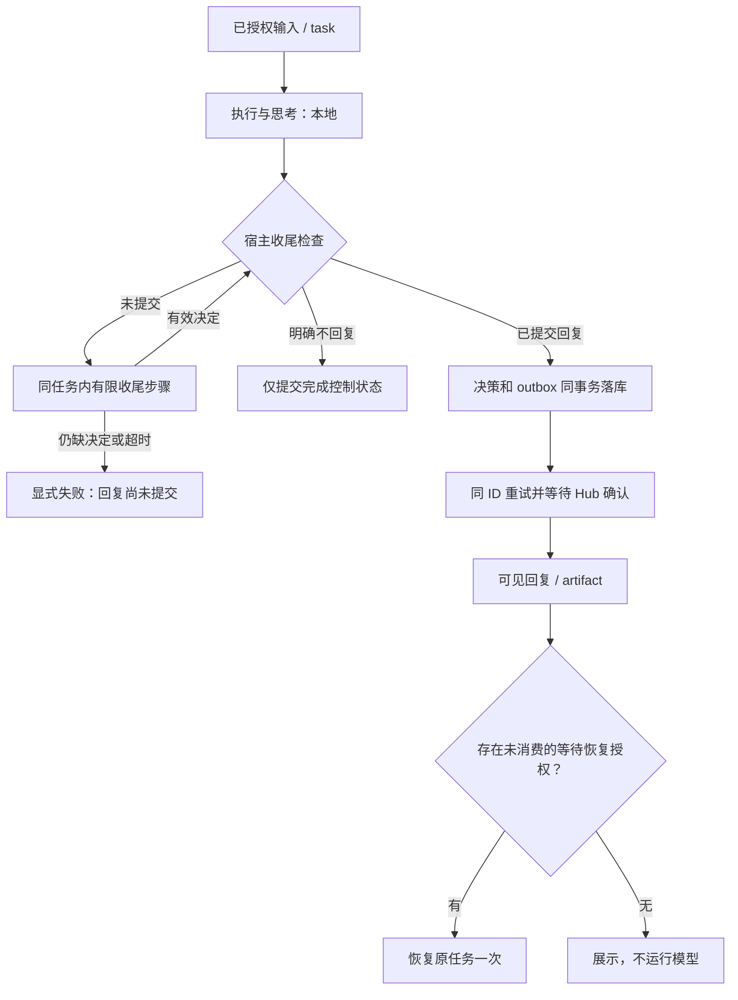

# 回合完成、可靠回复与镜像输出授权

日期：2026-11-11。调查基线：`1982bec`，Hub / 插件 V0.3.2。

状态：**调研与实施方案，尚未实现本文件描述的 host / Hub 协议重构。**
最初同批代码修复仅为远程聊天引用的颜色；后续已增强现有工具的系统提示，仍不
代表新完成工具、草稿引用、收尾检查或镜像重构已经生效。此文修订
[显式外发方案](explicit-outbound-and-dialogue-control.md)中“未发送即可视为不回复”
的假设，并将本地 Bot 回报和镜像网关纳入相同的输出授权模型。

群聊里“一个对话链是什么”、多 Bot 分叉/汇合及复杂场景的可视化推演，见
[对话链模型与十种情景](conversation-chain-model.md)。话题链与一次自动执行授权
分开：人类明确追问可以开始下一次授权，普通补充和 Bot 接力不能自行重置预算。

## 0. 综合选择：统一任务结算，按出口授权

综合本地代码、当前远程实现及官方资料，建议保留 DSH 模型执行与现有 SQLite，
在插件和 Hub 建立共同的任务/结果契约。无需更换 Agent 框架或部署额外消息中间件。
公共任务核心放在插件本地，远程是传输与授权适配层。关闭远程 Hub 时，本地群和
Bot 派活照常运行，不要求发布身份或 Hub membershipEpoch；本地使用自己的 Bot、
任务与群成员版本，只有远程适配层验证 Hub 身份/epoch，不能混用授权上下文。

| 方案 | 优点 | 不能解决的问题 | 采用方式 |
| --- | --- | --- | --- |
| 本地群调度 + 私聊 work 树 | 宿主确定调用、自动交回、等待依赖，模型操作负担低 | 群与私聊规则不同；PASS、worked 等启发式；群 batch 非持久；输出受众继承过宽 | 迁移精确任务归属、调用/返回分离与结果汇合 |
| 当前远程显式发送工具 | 私密 final 不自动外发，输出意图可审计 | 工具可被遗漏；遗漏/失败被误判 no_reply；没有完整 task/waiter | 保留输出选择，补宿主完成检查及状态机 |
| 自动转发所有 final + 深度/数量限制 | 用起来简单，减少忘发 | 不能区分内部汇报；截断前仍会泄漏、空转 | 不采用 |
| 关键词结束 / 模型判断“谢谢” / 仅加提示词 | 成本低、可减少部分空转 | 文本含义不可靠，无法处理崩溃、重复与外发权限 | 只作表达指导，不作协议判定 |
| A2A 任务模型 + 有界运行器 + durable outbox / checkpoint | 状态清晰，结果关联原任务，可重启、可对账 | 本身不替产品决定受众，也不证明正文内容真伪 | 作为综合契约的基础，按现有规模实现最小必要部分 |

目标是：**模型负责内容与是否公开，宿主负责调度、提交校验、交付及结束。**
不要求模型维护重试、猜测接收方、自己发送回执或知道底层数据库状态。
正常一次完整工具提交就结束，不额外运行一个“审核模型”；遗漏时才执行最多一次
受限收尾。已有正文用 draftId 引用，避免再生成一篇长文。

### 出口策略

统一的是结果账本与调度，不是让所有本地对话都强制多调一个远程发送工具。
宿主创建任务时固定 outputPolicy，不能通过角色名字、模型参数或父 audience 改写：

| 场景 | 自动结算范围 | 何时必须显式公开提交 |
| --- | --- | --- |
| 本地用户直接询问 Bot | 正常最终答复可在结束时由宿主提交到这个确定的本地用户会话 | 出现混合/异步内部输入、改变目的地或额外外发时 |
| 本地 Bot 派活 | 最终结果可自动归还精确派单 work，类型是内部 work_result | 发给用户、远端或镜像时，不能把内部结果原样升级 |
| 本地专用群 Session | 当前 task 明确绑定 room_message 输出槽且输入独占时，可提交到该本地群 | 内部 reply、非群输出槽、混合输入、跨群、远端或其他出口时 |
| 远程 DM / 联邦群 | 自动处理接收、执行与已提交结果的投递 | 公开回复必须选择已有草稿、新正文或 no_reply |
| 用户镜像 | 只转发有精确用户目的地授权的 output commit | 异步 Bot 回报后形成的用户答复需独立提交，不继承祖先权限 |
| 思考、内部笔记、来源不明确 | 只留本地执行日志 | 不允许将 reasoning 块选作草稿；来源未明确前不发 |

本地自动结果只是精确目的地的正式提交，不意味着其他消费者也可读取并外发。
对于纯粹的直接用户答复，宿主可依预先配置的用户渠道绑定生成用户输出提交；
镜像仍消费这条提交而非原始 final。Bot 返回触发的回合则必须经过独立 user_reply
选择；继续原任务的资格不能代替该选择。专用本地群的自动展示也不授予 WeLink
或其他远端出口权限，避免由“同一个用户拥有”推导出任意跨会话可见。
“独占”必须检查当前 task/input/output slot，不能只检查 Session 属于某个群。
在群 Session 收到的内部 work_result 也不能自动升级成群正文；不同目的地的
混合输入关闭隐式提交，只允许从宿主给出的有效输出槽显式选择。

### 最小持久模型

保留原有 conversation / membership / outbox / inbox，增加或整理五种逻辑记录：

1. **Task**：taskId、rootId、parentTaskId、输入消息/投递、执行主体及 epoch、
   outputPolicy、生命周期、截止时间和预算。补充信息进入同一 task；新问题创建
   新 task，但不自动刷新原 root 的配额。
2. **Waiter / continuation**：父任务在等哪组子任务，all/any 策略、joinGeneration、
   已消费标记。消费与恢复入队同事务，重复/迟到结果不能再次恢复；不同等待批次
   可以各恢复一次，不把“整个父任务永远只能恢复一次”当规则。
3. **Draft**：当前任务的不可变普通正文引用、块索引、hash 与来源。不是公开内容，
   不进入 Hub、镜像或普通聊天历史。
4. **Outcome / output commit**：唯一终结槽、reply/no_reply/failed 等明确结果、
   payload/hash、目的地授权、提交方式（宿主允许的本地结算或模型显式提交）。
5. **Transport / audit**：稳定 intent/message/output ID、确认状态、错误、消费游标。
   沿用既有 outbox；审计只存必要元数据，不复制思考。

这些是职责，不要求新建五套系统。输入接收、任务创建和去重须共享事务；接收结果、
结算依赖、创建恢复意图也须共享事务。实际模型调用在事务外运行，跨崩溃边界
用任务身份、已有 Session 记录和执行归属校验恢复，不能用数据库锁包住 LLM。
派子任务时，父任务的 waiter 登记与 request outbox 必须同事务提交，避免极快的
结果先到、等待关系尚未建立而漏掉恢复。
外部 Shell 等非幂等工作已运行但结果未知时，显示 uncertain 并核实，不能因为
消息待发送而重新执行整项工作。

### 一次完整协作

```text
用户给 A 一项工作
  → 宿主登记父任务 T
  → A 给 B 派子任务 T1（同时登记等待者）
  → B 生成结果
  → 本地内部结果按绑定自动交回；跨机结果必须明确提交
  → 提交后宿主负责持久发送，不再要求 B 重复生成
  → 结果/明确不回复/失败结算 T1，按等待策略恢复 T 一次
  → A 提交面向用户的总结
  → 任务结束，普通确认和状态回执不唤醒 B
```

若 A 确有新问题，显式建下一子任务并登记下一等待批次；它属于同一 bounded root。
从“回复到了”直接推导“必须再回复”，在任何传输和镜像出口都不成立。
远程先沿用当前 depth 8 / activation 32 默认保险，本地可采用不同的可信任务预算，
不要把旧的全团队固定上限重新套回正常长任务。统一约束按 root/主体/期限执行，
模型不能自发换 root 重置；本地用户可明确延长已授权工作。预算到限停止新增
激活，不删除已授权结果或假装工作成功；已过期任务的迟到结果可在权限仍有效时
保存供查看，但不自动恢复已结束任务。

## 1. 已确认的问题

### 1.1 遗漏决策被错误地终结为“不回复”

`runtime.js` 的 `export()` 查询 `completedToolReply()`，将 accepted 映射为
sent、pending 映射为 pending，**其余全部映射为 no_reply**。其余包含：
没有调用工具、只有思考/空正文、以及真正尝试发送但被拒绝。

`queue-store.js::recordDecision()` 随即生成 `noReply` 回执；`replyDeclined()`
阻止后续补发。Hub `store.js` 收到回执后写入 `bot.work.completed` 并关闭该
delivery 的回复授权。因此问题不仅是界面不显示，错误终结还可能让随后正确的
发送无法继续。现有测试确实将“普通 final 自动 no_reply”当成预期行为。

使用现有 `communication-updates.test.js` 的内存 fixture，调用生产 runtime / queue
复现的结果如下；未连接生产 Hub，未读取用户数据：

| 输入情况 | 当前决策 | noReply 回执数 | 本地禁止补发 |
| --- | --- | --- | --- |
| 有 final，未提交任何决定 | no_reply | 1 | 是 |
| 只有 reasoning | no_reply | 1 | 是 |
| 显式 decline | no_reply | 1 | 是 |
| 显式回复待发送 | pending | 0 | 否 |
| 显式回复发送失败 | no_reply，transport=failed | 1 | 是 |
| 显式回复已获 Hub 确认 | sent | 0 | 否（原回复另有幂等保护） |

已实现的 reasoning / text 类型隔离仍然有效；不能为修复可用性重新自动公开
普通 final。缺的是**强制完成契约和正确的失败状态**，而非再加一句提示词。

### 1.2 Bot 回报继承了整轮的用户输出资格

当前本地路径：

1. `handoffs.js::openWork()` 继承父 work 或发送者当前回合的 audience。
2. `turns.js::answerSender()` 在内部答复中携带 rootAudience。
3. `turns.js::userAudience()` 因 `protocol=reply && rootAudience=user`，或父 work
   的 audience=user，将被唤醒的整个回合判成 user。
4. `claimTrigger()` 将这个结论写入 turnAudiences；`feed.js` 的镜像输出筛选读取
   该 audience，没有独立的逐输出授权记录。

用户报告的“12 次 user、3 次 internal”没有完整事件轨迹，本轮不能重建这些现场
次数。代码证明这条继承路径存在；不同父任务可以产生不同标签。
现有 `handoff-results.test.js` 甚至专门验证了委派任务返回后继承 user 的行为。

原设计试图保留“用户要求 A 工作，A 委派 B，B 返回后 A 向用户汇总”的能力。
但它同时让 A 在该回合里的内部笔记获得外发资格。**任务由用户发起，不等于
这个任务中每一段文本都可以给用户。** 单行删除继承会压住泄漏，也会吞掉合法
汇总；只检查 triggerOrigin 同样无法同时解决两者。

另有一个独立且更直接的缺陷：`parts.js` 将 `assistant/message` 中每个 text 块
投影给 feed，`feed.js` 在事件到达时立即输出。现有内存夹具探针中，带 user 标签
的 local-bot/reply 回合在同条消息同时生成 text 和 tool-call，**尚未 turn/end，
`INTERNAL_PRE_TOOL_CANARY` 已进入 user-output SSE**。后续 mixed 输入将标签降级
也无法撤回已外发内容。此前文档对“规范流不含中间步骤”的描述不符合此实现。
只过滤 reasoning 或当前消息的 tool-call 仍不够，之后的 steer 也可能替换正文；
必须等待精确输出提交，再由提交账本驱动镜像。

## 2. 业界机制及本项目采用的部分

以下是官方资料中的机制，不表示这些项目已经实现 DS Bot 的权限或同样的产品行为。

| 来源 | 可借鉴机制 | 本项目的落点 |
| --- | --- | --- |
| [A2A：Life of a Task](https://a2a-protocol.org/dev/topics/life-of-a-task/) | 会话上下文、任务、消息、结果及终态分开；终态任务不隐式重启 | conversationId 不再兼任永久任务；结果关联 task，后续工作明确新建 task |
| [OpenAI Agents：Output types / Forcing tool use](https://openai.github.io/openai-agents-python/agents/) | 结构化输出、工具选择与运行结束可由运行器控制 | 完成要有可校验的决策，不依赖模型记住“还有一步要发送”；不在整个工作阶段强制调用有副作用工具 |
| [AutoGen：Termination](https://microsoft.github.io/autogen/stable/user-guide/agentchat-user-guide/tutorial/termination.html) | 编排器提供状态化、可组合的停止条件 | 一次性等待恢复、任务完成、轮数/时间/预算限制由代码执行 |
| [RabbitMQ：Reliability](https://www.rabbitmq.com/docs/reliability) | 生产者确认与消费者确认分开；确认丢失会导致重传，需要幂等 | 已排队、Hub 已持久化、接收端已持久化、工作完成分别记账 |
| [AWS：Transactional outbox](https://docs.aws.amazon.com/prescriptive-guidance/latest/cloud-design-patterns/transactional-outbox.html) | 业务记录和待发送事件同事务提交，消费者处理重复 | 输出决定与 outbox 原子落库；沿用相同 messageId 重试 |
| [Temporal：Retry Policies](https://docs.temporal.io/encyclopedia/retry-policies) | 确定性编排与可失败操作采用不同恢复语义 | 发送重试不等于模型/工具重执行；为失败类别明确配置重试边界 |
| [LangGraph：Persistence](https://docs.langchain.com/oss/python/langgraph/persistence) | 持久检查点支持线程恢复，内存检查点不能跨进程存活 | 等待批次、完成与补全次数持久化，不能仅靠进程内 Map |

综合建议：**宿主强制收尾 + 持久提交 + 独立任务调度 + 逐输出受众授权**。
无需引入 RabbitMQ、AutoGen 或替换 DSH；借鉴其契约，复用现有 SQLite、outbox、
inbox 和公开 DSH API。正文关键词、礼貌用语识别、模型自述均不作为协议真值。

## 3. 三条独立状态轴

不能再用一个 `completed` / `no_reply` 同时表达以下三件事：

| 轴 | 示例状态 | 谁确认 |
| --- | --- | --- |
| 工作执行 | admitted、running、waiting_dependency、computed、failed、canceled | 宿主调度器与持久执行记录 |
| 对外决策 | undecided、reply_committed、explicit_no_reply、decision_failed | 宿主校验后的完成提交 |
| 投递 | queued、hub_accepted、recipient_stored、rejected、expired、uncertain | 对应端点的确认或确定错误 |

对需要显式公开的任务，模型正常完成计算最多证明 computed；异常结束必须保留失败原因。`reply_committed`
证明有待交付的公开内容，不能
证明 Hub 收到了；Hub 收到也不能证明另一 Bot 已处理。只有显式 no_reply 才能
显示“选择不回复”；遗漏、失败、撤权都不能转换成该状态。



## 4. 宿主拥有完成契约

### 4.1 一份明确的提交

拟新增统一工具 `complete_communication_turn`，三种调用形态如下。
**该工具、草稿引用和宿主收尾检查尚未实现或注册**；这些示例属于实施契约，
不能放进目前仅提供旧工具的生产模型提示。

发送已有正文草稿，不要求模型重复生成长文：

```json
{"decision":"reply","mode":"use_draft","draftId":"draft-123"}
```

重新撰写给当前受众的正文：

```json
{"decision":"reply","mode":"new_text","text":"给当前受众的结果"}
```

明确不回复：

```json
{"decision":"no_reply"}
```

`reply_to_communication` 和 `decline_communication_reply` 兼容映射至此契约。
本地校验采用严格的互斥分支：use_draft 只能带当前授权集合内的 draftId，不能
同时带 text；new_text 必须带非空且合规长度的 text，不能带 draftId；no_reply
不能带 mode、draftId 或正文。附件沿用现有独立校验。作者、目标会话、输入 delivery、
membershipEpoch、task、root、受众与授权由宿主绑定，不能让模型通过原始身份/目标
参数自由选择。reasoning、普通 final 和工具原始结果都不能隐式成为公开正文。

宿主在确切的 assistant 输出已持久化后，给可选的普通正文快照分配不可变 draftId，
绑定 task、Session、turn、输出事件序号、确定的 text 块索引、内容 hash 和当前
membershipEpoch。引用时读取这份确定快照，不重新取“最新一条”或模糊的“上一句话”。
仅当前未结算任务的合格正文可被显式选用；跨任务、旧 epoch、已失效或找不到的 ID
必须报错，不能回退为另一段文字。reasoning 块、工具结果及含 tool-call 的中间
assistant 消息不注册为可发送草稿，不要求模型暴露思考过程。只有 reasoning 或
空正文时不生成 draftId。

草稿登记不是外发授权，也不能自动触发 outbox。模型调用 use_draft 才明确批准
将该正文原样提交给已绑定受众；若其中混有内部汇报，应选择 new_text 另写公开回复。
宿主按块类型和绑定保证边界，不宣称能从任意普通 text 中语义识别所有内部内容。

唯一键是 `(taskId, recipientPrincipalId, membershipEpoch, outcomeSlot)`。
一次任务最多一个终结决定；新 tool callId 不能绕过此限制。相同决定重试返回
原回执；不同决定竞争返回冲突。进度消息是独立受限操作，不占用终结槽，也不能
凭进度消息让收尾检查通过。提交成功后发生的私密 final 不再改变决定。

### 4.2 正常回合结束前检查

通过公开 `agent/turn-stopping` hook 检查任务账本：

- 有回复提交：允许结束模型计算，交由 outbox 继续发送，不再让模型重做工作。
- 有显式 no_reply：允许结束，发控制状态，不新增聊天正文。
- 没有提交：记为 needs_decision，注入宿主来源的收尾 notice，**最多补全一次**。
  该步骤只允许完成工具；schema 和执行侧同时限制，不能重新运行 Shell、文件写入
  或另一轮派单。notice 明确说明“先前文字没有发送”，列出完成工具及实际可用的
  调用形态；存在合格草稿时给出 draftId，不重复整段长文，不复制思考到公开回复。
- 仍未提交、持续非法参数、模型失败或超时：记 decision_failed，显示
  `COMMUNICATION_DECISION_REQUIRED` 或具体失败码，不能发 noReply。
- 任务正在等已登记的子任务：保留 waiting_dependency，不误判成遗漏或主动沉默。

“最多一次”以原 task/delivery 为单位，而非进程或 Session 回合号。进入补全前
持久化 attempt、noticeId、原始 source、deadline；崩溃恢复核对公开 Session
日志是否已注入，不重新派发原工作。存在不确定性则明确 blocked，不能凭没有看到
回执再次执行有副作用的工具。主动取消、撤权、退休身份、过期 epoch 均停止补全。

一个回合的多个独立输入必须分别建 task 和结算，不能继续用
`completedOutputs().inputs.at(-1)` 代表全部。补充信息归原 task；确需一个结果
覆盖多任务时，宿主逐项验证并原子结算明确集合，不能靠最后一条消息猜来源。
首版收尾阶段由宿主每次绑定一个待决 task；若工作阶段允许并行多 task 提交，
只能使用宿主生成的不透明 outcomeSlot，从当前已授权待决集合选取，并校验其
Session、输入及 epoch。该 handle 只消除歧义，不能创建新授权或改变目的地。

### 4.3 系统提示与宿主提醒

系统提示应将正文边界置于独立、靠前的规则段落，并明确“调用工具”是实际工具
调用，不是在普通正文里打印工具名、JSON 或“已发送”。未来完成工具启用后的英文
规则模板为：

```text
# Required remote reply submission
Reasoning, notes and ordinary final prose stay in the local execution journal.
They are NOT forwarded to the remote conversation automatically.
Before finishing this task, call complete_communication_turn to submit a public
reply or explicitly choose no_reply. Writing an answer, a tool name, JSON or
"sent" in ordinary prose is not a submission.
To send an eligible existing draft unchanged, use decision="reply",
mode="use_draft" and the exact draftId supplied by the host. Do not rewrite it
merely to send it. To write a different public reply, use decision="reply",
mode="new_text" and text. To send nothing, use decision="no_reply".
Never send reasoning or internal reports. A draft is private until you explicitly
submit it; if it contains internal material, write a separate public reply.
Pending means queued, not delivered. Follow the recorded submission status;
do not submit another reply to compensate for an uncertain send.
```

仅在宿主账本证明当前任务没有终结提交、且工具确实已注册后，注入以下英文提醒。
`{{draftId}}` 由宿主从当前任务合格草稿生成并进行 JSON 字符串编码，不能来自远端
正文或未经校验的模型文本。正文不重复粘贴到提醒中：

```text
[Host completion notice]
Your previous ordinary final prose has NOT been sent to the remote conversation.
No completion decision is recorded for this task. Complete this task by calling
the tool complete_communication_turn with exactly one of these argument shapes:

1. Send the existing draft unchanged:
   {"decision":"reply","mode":"use_draft","draftId":{{draftId}}}
2. Write and submit a different public reply:
   {"decision":"reply","mode":"new_text","text":"Your public reply"}
3. Explicitly finish without a message:
   {"decision":"no_reply"}

Call the tool; printing these examples in ordinary prose does not submit them.
Review the selected draft for this audience. Do not send reasoning or internal
reports. This step permits completion only: do not repeat work tools or delegate
new tasks. A queued submission is not proof of delivery.
```

没有合格 draftId 时删去第 1 项并说明“没有可发送的正文草稿”，只展示新写/不回复
两项；不能给空 ID 或虚构示例 ID 让模型猜。已有 pending/accepted 提交时不发送
此提醒，继续处理原 outbox；重复工具调用仍受同一终结槽幂等约束。

当前生产提示只能强调实际可用的 `reply_to_communication({text})` 与
`decline_communication_reply({})`。拟注册工具、draft 参数及上述自动提醒必须与
其运行时实现一起启用；不能把提示词更新当成收尾检查或草稿发送已经实现。

### 4.4 DSH 可行性与限制

[DSH 公开 Agent 文档](https://github.com/deepseek-ai/deepseek-harness/blob/master/packages/core/agent/README.md)
提供正常结束前的 `agent/turn-stopping` 和 steer；本仓
[既有恢复实验](p0-recovery-gap.md)记录了 pinned 0.2.1-rc.4 上使用此 hook。
现有 runtime 的 scoped 工具与来源校验可承接专用收尾阶段，但必须新增原生验收，
尤其是 notice 来源、结束时序、持久化与取消竞争。

不能把当前 DSH master 的新功能当作 rc.4 已有能力，也不能假定所有 provider
支持 strict JSON Schema / `tool_choice=required`。首版依赖插件完成工具、本地
参数校验和完成检查；provider 的结构化约束只是增强。若公开 API 无法覆盖某个
生命周期点，提交上游需求，不能修改 DSH 安装树或偷偷接管其模型循环。

## 5. 提交、发送与回执

沿用 SQLite outbox，增加 `task_outcomes` / `output_commits` 等职责清楚的持久记录
（实际表名在实现时统一）。一次事务写：决策、公开 payload/hash、稳定 messageId、
绑定授权和 outbox。Hub 在自己的一个事务内写消息、结果/终态及投递记录。

断网重试只重传原 ID / 原 payload；Hub 按 ID + hash 幂等。ACK 丢失保留 uncertain
或 queued，由查询/重传收敛；不能换 ID 再生成答案。确定拒绝记 rejected，保留
错误原因；权限/epoch 不符不能自动换身份补发。状态更新与界面只读同一份账本。

显示文案建议：

| 状态 | GUI / CLI 表达 |
| --- | --- |
| computed + undecided | 正在完成回复决策 |
| decision_failed | 回复尚未提交，需要处理 |
| reply_committed + queued | 待发送 |
| hub_accepted | Hub 已接收 |
| recipient_stored | 对端已收取 |
| explicit_no_reply | Bot 选择不回复 |
| rejected / expired / canceled | 发送失败 / 已过期 / 已取消，附具体原因 |

模型声称“已发送”不改变状态。可查询提交结果；网络待确认时无需让模型无限等待。
重试按钮重试投递，重新执行按钮创建明确的新任务，两者不可混用。
这实现可恢复的至少一次传输与幂等逻辑效果，不承诺所有外部 Shell 副作用 exactly once。

## 6. 发布消息与运行模型分离

Hub 显式保存 task/subtask、父任务、root、等待者和一次性 continuation grant。
每份授权绑定主体、会话、epoch、task、失效条件；由可信宿主/Hub 创建，不由正文
或模型声明 `kind=result` 获得。

| 消息/操作 | 展示行为 | 调度行为 |
| --- | --- | --- |
| request | 展示请求 | 有授权才建目标任务并激活一次 |
| result | 展示已提交结果 | 只可消费对应子任务的一次性等待恢复授权 |
| notice / 进度 | 可展示 | 不创建任务、不自动唤醒 |
| ACK / no_reply / failed 控制状态 | 更新状态 | 不生成聊天/确认链 |
| 显式 follow-up | 展示新问题 | 在同一 root 下建下一任务，检查剩余预算 |

任务调度器可在依赖任务以 result/no_reply/failed 结束时，按原等待策略恢复父任务
一次或直接结算失败；这是已登记依赖的完成，不是控制消息自己给任意 Bot 新派单。
并行多个子任务使用明确 all/any 策略并原子消费恢复授权，不能每来一条状态都跑一轮。

DM 与群使用相同机制。`replyToMessageId` 只表达引用，`mentions` 只表达选中成员；
它们本身不等于可无限调用的权限。普通 Bot 回答不广播给群默认接收列表。
群中多个默认 Bot 各有自己的 task 和 outcome，不以抢到同一个完成槽的方式工作。

例如 A 请求 B 校验结果：B 提交 result，A 原任务恢复一次；A 给用户或群提交最终
结果，不再激活 B。若 A 确实有下一项工作，则显式发起 follow-up。是否继续合作
由任务操作决定，不通过“谢谢”“收到”之类自然语言猜测。

已有 depth 8 / root 32 默认限制保留为保险，同时补 deadline、fan-out 和主体新根
速率限制。子任务和 follow-up 不重置 root 配额；长期 DM 不永久共用 genesis 根。
新根只由明确的本地用户/调度任务或已授权的主动工作策略创建，远端执行工具不能
省略 cause 冒充新的本地请求。预算耗尽明确显示“消息已保存，目标未被启动”和
具体原因，不能用一个 success 掩盖唤醒失败。

## 7. 镜像使用逐输出授权，不继承整轮可见性

### 7.1 保留任务来源，分开公开资格

`rootAudience` 可保留用于溯源，但不能再作为允许镜像的布尔授权。
区分：

- **work_result**：发给发起任务的本地 Bot 的内部协议结果。
- **user_reply**：明确提交给绑定的用户会话的公开结果。
- **remote_reply**：明确提交给绑定远程会话的结果。
- **private_note / reasoning**：只留执行日志。

local-bot 的 reply 输入始终是内部协议输入；返回结果可唤醒原先的用户任务，
但不能把该回合全部文本升级为 user。恢复授权只允许继续执行；公开授权绑定
特定输出和目标，是另一个动作。

正常流程仍成立：用户 U→A→B，B 的 work_result 只给 A；A 处理结果后通过受约束
的 user_reply 完成提交，宿主检查 U 原任务与目标绑定，形成新的公开输出。
若 A 仅写内部笔记，则不镜像；若忘记提交真正给 U 的汇总，走同样的有限收尾检查，
不会在防泄漏之后又悄悄吞掉用户答案。直接用户聊天可以保留其明确用户输出路径；
异步 Bot 返回、混合输入及恢复回合不得沿用整轮自动公开。
直接用户 answer 也应在正常收尾时由宿主验证本轮始终拥有唯一用户目的地，再正式
生成 output commit；不要求普通用户聊天额外调用发送工具，也不提前镜像中间正文。

`handoffs.openWork()` 应继承 task/root/parent 的身份，不继承“全部正文可见”权限。
`turns.userAudience()` 和历史投影改为查询输出提交记录。对于同轮用户与 Bot 输入，
逐输出绑定原任务；不能让最后到达的输入决定前面所有内容的受众。

### 7.2 镜像出口契约

现有 `/api/bot/user-output` 应演进为只发已提交 `user_reply` 的规范事件，至少带
outputId、commitId、sourceTaskId、origin、outputKind、目标会话/绑定、payloadHash
及持久游标。服务端校验提交记录与目标权限，不能只查 `audience=user` 标签。

网关只消费规范事件，按 outputId 去重、保存游标并确认已推送；不能订阅原始 DSH
assistant final 或读取内部 work_result 后自行推测目标。重连从已确认游标补投，
Hub 控制回执不进入用户聊天流。不存在匹配绑定的输出只保留本地并报诊断。

外部接收人映射由网关持有时，网关也必须校验 Bot/会话与其登记的用户绑定；插件
不能凭一个 botId 证明网关最终发送给谁。需要对应适配器共同升级。
还需核实外部平台是否支持稳定 outputId 的幂等发送或结果查询：平台已接受、网关
确认尚未落库时崩溃，单靠本地去重不能同时保证不丢且不重。没有平台侧支持时必须
记录 uncertain 并对账，不能将 SSE 消费确认或平台接受等同于手机用户已经收到。
**WeLink 网关代码不在本仓库，本轮不能宣称其已修复。** 当前版本的 SSE 只是
实时过滤流，没有持久补投/确认；这些是本方案待建设的内容。继续读原始 Session
日志的旧消费者仍能读到内部正文，不能靠 UI 隐藏保证安全。

逐输出授权保证路由边界，不证明远端内容真伪，也不能语义保证模型显式提交的
每个字都适宜披露。原有最小数据暴露、工作权限和敏感披露审批继续独立执行；
此前暂缓的 D4 证据真值问题不在此处暗中扩项。

## 8. 迁移与实现顺序

新增能力按协议协商，例如 `task-outcomes-v1` / `output-commits-v1`，名称待最终实现
统一。GUI 或文案更改不增加协议门槛；不靠 Vx.x.x 相等判断能否通信。
新任务语义必须同时检查 Hub 与参与客户端能力，旧客户端不能被当成已经遵守它。
兼容模式显式说明限制，不能悄悄回退成自动 final 外发。

历史隐式 no_reply 已经关掉的授权不能自动复活，也不能扫描旧 final 批量补发。
对能辨别的旧隐式决策显示“旧版隐式结束”，人工重做是新任务；无法辨别则记录
legacy/unknown，不推断原意。新的 gate 只作用于升级后登记的任务。
旧 pending 的显式发送保持原 ID 恢复；旧自动 export 继续隔离。
镜像旧游标以前未授权的正文不能在迁移时作为用户输出补播。

建议按以下四个可独立验收的提交组落地，不在每个提交自动刷版本：

1. **完成状态与宿主 gate**：修正 `runtime.export`、queue 决策与 rejected 状态；
   注册 turn-stopping；来源/工具限制、持久补全预算、GUI/CLI 失败可见性。
2. **输出事务与任务协议**：Hub 原子 outcome、task/continuation、DM/群统一恢复、
   activation 结果与能力协商；复用现有 outbox/inbox。
3. **本地输出与镜像**：替换 handoffs/turns 的隐式 audience 权限继承；输出提交表、
   user_reply 完成入口、规范 feed 的持久游标与确认；外部网关单独对接。
4. **迁移和端到端验收**：新旧组合、崩溃窗口、真实模型遗漏工具，以及失败提示。

每组都必须保持 reasoning 本地，远程及异步/内部执行的普通 final 不自动变成跨出口
公开正文，禁止默认唤醒回路。本地内部结果和专用群展示只按第 0 节的精确目的地
结算；直接用户 answer 依第 7 节的正式提交规则处理。只改提示词、
自动转发所有 final、仅删除 audience 继承，均不能作为这份方案的完成标准。

## 9. 必须通过的验收

| 场景 | 验收结果 |
| --- | --- |
| 模型只写“已回复”，漏掉提交 | 同任务有限补全后一次公开回复，或明确 decision_failed；绝不隐式 no_reply |
| 长篇正文已生成，补全时选择 use_draft | 只提交同一 draftId 对应的原文一次，不要求重写；普通正文不因登记草稿提前外发 |
| 草稿仅有 reasoning / 混入工具调用 / 跨任务或旧 epoch | 不提供草稿选项或拒绝引用，不回退到最近一条正文 |
| 提醒缺失工具 / 工具未注册 / 没有合格草稿 | 不生成不可调用的提示；只列实际支持的调用形态，无虚构 draftId |
| reasoning-only / 空 final | 不外发；进入明确决策路径，不猜主动沉默 |
| 显式不回复 | 一个终结状态，零聊天消息、零确认链 |
| 显式提交后又写私密 final | 只发提交文本，私密 canary 不进任何公开出口 |
| 待发送 / 确认丢失 / Hub 拒绝 | 状态准确，不变 no_reply、不重生成答案 |
| 提交前后、发送前后、ACK 前后崩溃 | 同 ID 收敛；无重复消息、完成或 AI 激活 |
| 漏工具持续发生 / 参数反复错误 | 持久预算耗尽后失败；重启不补充预算 |
| 同回合多输入 / 新补充 / 两端同时发起 | 分任务、分授权，无 at(-1) 串源 |
| request→result→ack | 只恢复预登记等待者一次，ack 不唤醒 |
| 有用的后续问题 | 显式下一任务可执行，仍沿用原 root 预算 |
| 多 Bot 默认接收 / 群内并行子任务 | 各自结算；父任务按等待策略恢复一次 |
| 已退休 / 撤权 / epoch 改变 / 用户取消 | 不重试模型、不自动换身份；显示具体原因 |
| 用户→A→B→A 汇总 | B 的内部结果不镜像；A 提交的 user_reply 正常到用户 |
| 内部 Bot→A，发送者恰好在用户回合中 | 内部正文不因祖先 audience=user 外发 |
| 混合输入、重启、历史投影、旧标签 | 无授权输出记录即不镜像，不因回放恢复旧权限 |
| 工具调用前正文 / 随后被 steer 替换的正文 | 提交前不进入 SSE；后续标签变化不造成已外发内容无法撤回 |
| 网关断线补投 / 重复事件 / 错误接收人绑定 | 去重、保留游标、错目标拒绝；受测适配器不再订阅原始日志 |
| 外部平台接受后、网关确认前崩溃 | 有幂等/查询能力则收敛，否则保留 uncertain 并进入对账，不虚报已送达 |
| 关闭远程 Hub / 从未入会 | 本地群、内部派活、结果归还与用户答复独立正常运行 |

先用两个真实隔离 DSH + 自有 Hub + Mock 注入上述失败，再用真实模型测试“只写
final”“写谢谢”“误称已发送”等行为；判定依赖 Hub 消息、任务账本、激活次数
和镜像出口，不能依赖模型口头自证。真实模型测试需要实际可用的授权测试凭据；
本次调研没有运行真实模型或生产网关。

## 10. 本地群聊和 Bot 派活的对照

本地行为有两套调度，不能把全部保护都归到同一种机制。

### 本地群聊

- `groups.js` 的公开 `llm/stream` 插件钩子识别群入口 Session，由宿主合成
  `group_relay` 调用并在转发结束后结束入口回合。不是模型自行记住转发；成员
  各自的群 Session 才正常运行模型。标题等辅助模型请求不走此分支。
- `openingCall()` 按 @、群模式、admin、askedBy 选择发言者。普通成员最终正文
  不带 @ 时不会再广播给全群；本人不会因为自己的帖子再次被调用。
- `memberTurn()` / `roomWaiters` 绑定具体 exchangeId，`turns.js` 在回合完成时
  自动交回最终正文，成员不必再调用一个发送工具。由此减少“生成了答案却漏发送”。
- `callFrom()` 的 called 集合使一个成员回合对每个目标最多调用一次。成员正文
  中的 @all 广播限 admin；同时叫多个成员时，用 batch 汇合，在符合返回条件后
  恢复 caller，而非每个早到结果都启动一次汇总。
  但自动恢复还有 `batch.worked` 等条件：合成探针中 Chief 调用 Writer，Writer
  无工具直接回答“结果是 4”，结果已进入群聊，Chief 却未再次运行。工具调用或
  “需要调用方决定”的正文识别会影响是否恢复；这是可见消息与任务继续的差异，
  也说明新方案应使用明确 result/continuation，不继承 worked/关键词猜测。
- 没有待运行成员、待处理调用或新输入时 round 结束。连续无工具且被识别为确认/
  重复正文的 Bot 接力达到 `ROOM_IDLE_RELAY_LIMIT=6` 后暂停，等待用户继续。
  这是启发式保护：新措辞、真实或无用的工具调用都可能使其不命中，不能当作
  任意任务的硬预算。当前代码并没有一个覆盖所有本地协作的总跳数/总消息数上限。
- `[PASS]` 和空正文被当作主动跳过。现有 `isPass()` 连以 `[PASS]` 开头、后面
  还有文字的情况也匹配，单测明确包含此行为。这是正文被忽略的可复现路径之一，
  不能据此断定用户某次现场丢失就是这个原因。结构化 no_reply 优于继承此标记。

### 本地 message_bot 派活

- `handoffs.js` 保存父子 work、待完成项及结果；`tools.js::message_bot` 会拒绝
  把新请求派回正在等当前结果的上游。B 不需要另发消息通知 A，结果自动沿原路径交回。
- `turns.js::expectsReply()` 只把 request / stopped 看作需要自动答复的输入，
  reply 不是新的 request。A 收到 B 的结果后，不会仅因回合结束就再自动答 B。
- B 若继续委派 C，`finish()` 会持有 B 的中间结论，等 C 回来后再把最终正文与
  子结果交给 A；不会先以“我已派出”关闭 A 的等待。结果与父工作关系可持久恢复。
- 同一发送者、同一 work 的未读请求可合并为一个 exchange；不同 work 不混合。
  可选 request_id 提供持久幂等，重复同内容返回原回执，不同内容拒绝；发送结果
  uncertain 时不盲目重发。未填写 request_id 并不获得该命名请求幂等保护。
- 群内 `message_bot` 相当于群 @，按群调度运行，不自动加入上述私聊 work 树。

### 对远程方案的影响

本地少风暴的主要原因是宿主知道“谁在等哪个结果”，并区分调用与返回；少漏发送
的重要原因是最终结果由宿主自动交回。提示词中的“不发感谢/确认”是辅助纪律。
当前远程取消自动 final 外发后，只保留可选工具、没有强制完成契约，因此增加了
本地没有的遗漏步骤。应迁移本地的确定调度、任务归属、结果汇合与完成结算；远程
保留显式输出授权，可通过 draftId 直接确认已有结果来降低操作负担。

不能照搬本地自动公开任意 final 或祖先 audience 继承：两者正是内部报告误发到
远端/镜像的风险来源。本地也并非完全可靠：有条件的启发式暂停、PASS 识别、
发送不确定窗口，以及内存中的 group round/batch 在重启时与持久状态重建的关系，
均需单独测试。`roomBatches` / `memberBatch` 是进程内 Map，已有恢复可以保留
askedBy，但不能据此保证重启后仍保有完整多成员汇合屏障。此处没有宣称定位了
用户现场的偶发漏消息，也没有修改本地调度规则。
